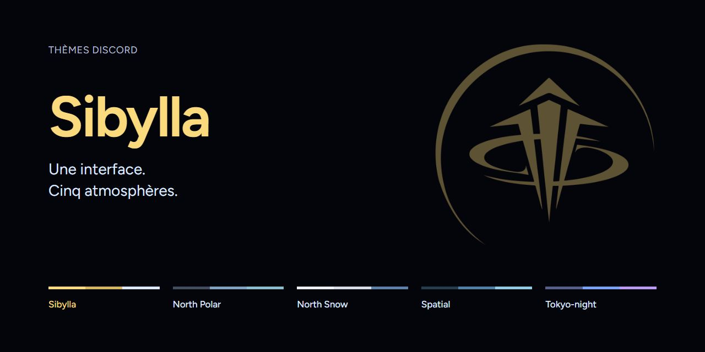
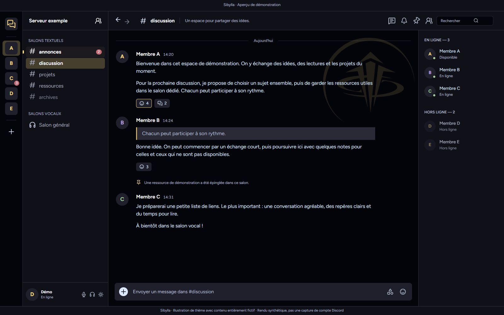
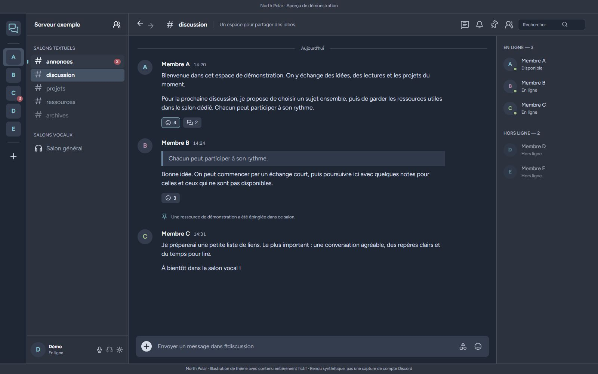
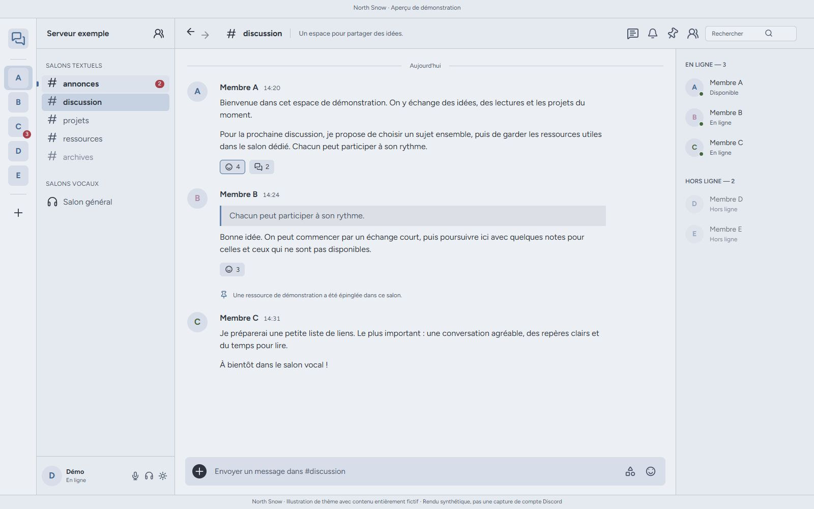
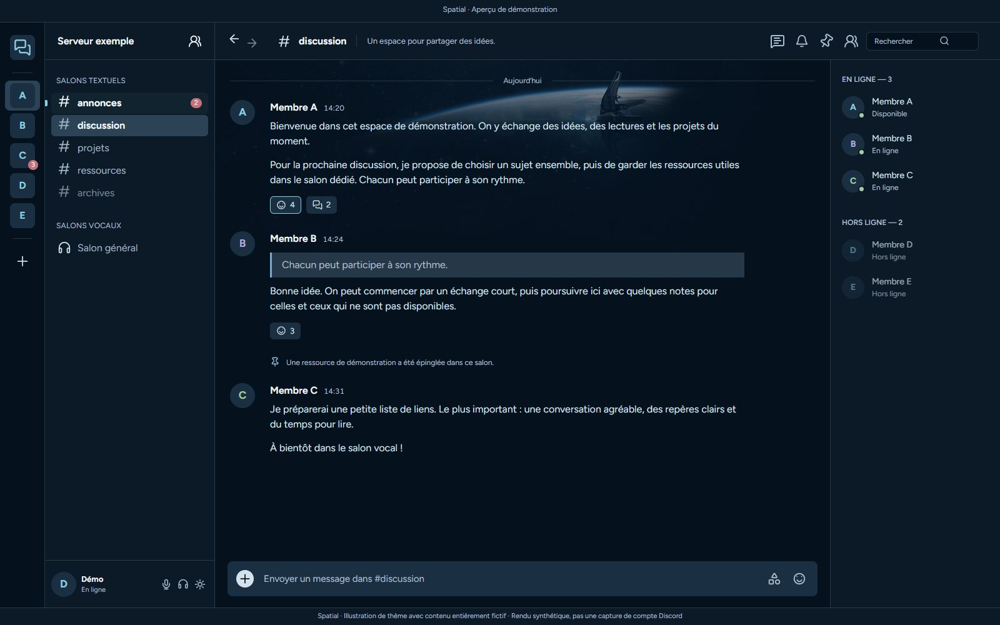
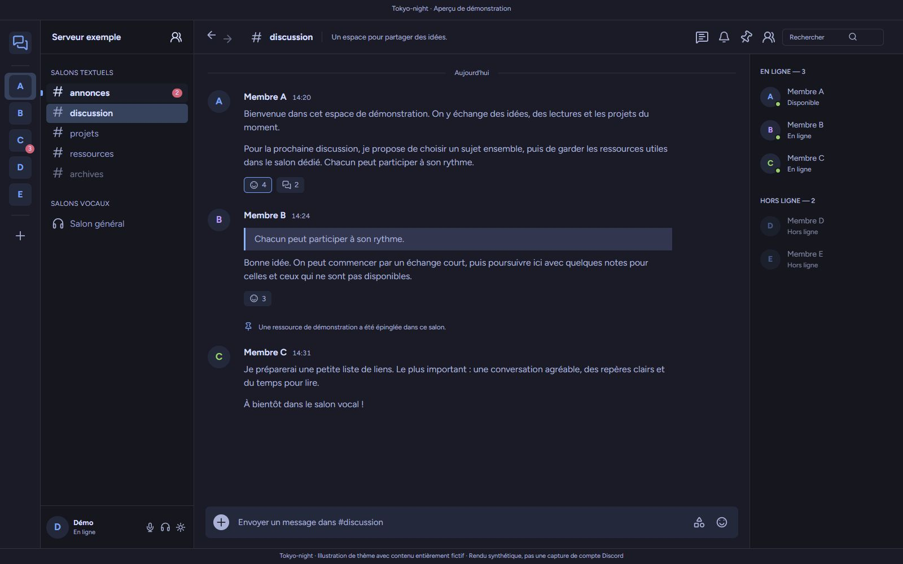

# Sibylla — thèmes Discord

**Sibylla** est le thème principal. **North Polar**, **North Snow**, **Spatial** et **Tokyo-night** sont ses quatre flavors autonomes. Les cinq versions conservent le même agencement, les mêmes icônes et les commandes natives de Discord.

Les cinq versions ont été testées et validées visuellement par le propriétaire le **25 octobre 2026**. Les contrôles automatisés et les limites de compatibilité sont détaillés dans [la validation](docs/VALIDATION.md).

## Choisir et télécharger

Aperçus avec un serveur, des membres et des messages entièrement fictifs, rendus avec le CSS actuel.

### Sibylla — principale

Minuit et or, avec le logo discret en haut à droite du chat.



[**Télécharger Sibylla — principale**](https://ussmarines.github.io/Sibylla-Discord-Theme/dist/sibylla.theme.css)

### North Polar

Nord sombre, version validée conservée.



[**Télécharger North Polar**](https://ussmarines.github.io/Sibylla-Discord-Theme/dist/north-polar.theme.css)

### North Snow

Nord clair : surfaces Snow Storm et textes Polar Night.



[**Télécharger North Snow**](https://ussmarines.github.io/Sibylla-Discord-Theme/dist/north-snow.theme.css)

### Spatial

Bleu orbital et vaisseau en haut à droite de la zone de messages.



[**Télécharger Spatial**](https://ussmarines.github.io/Sibylla-Discord-Theme/dist/spatial.theme.css)

### Tokyo-night

Tons nocturnes et accents bleus, cyan et violets.



[**Télécharger Tokyo-night**](https://ussmarines.github.io/Sibylla-Discord-Theme/dist/tokyo-night.theme.css)

## Installer le thème

1. Enregistrer le fichier choisi avec son nom complet se terminant par `.theme.css`. S’il s’affiche comme du texte dans le navigateur, utiliser **Enregistrer sous**.
2. Ouvrir **Paramètres → Vencord → Themes → Open Themes Folder**, ou le dossier des thèmes de BetterDiscord.
3. Copier le fichier dans ce dossier et activer la version choisie.
4. **Activer une seule version à la fois.** Une flavor inclut le thème entier : ne pas la superposer à Sibylla.

Pour mettre à jour une installation locale, remplacer le fichier existant par le nouveau téléchargement. Pour passer d’une version à l’autre, désactiver l’ancienne avant d’activer la suivante. Désactiver aussi les anciens thèmes Sibnight et les liens de thème en ligne ; du QuickCSS personnalisé peut entrer en conflit avec le rendu.

Les fichiers de `dist/` contiennent tout le CSS, les icônes et les fonds locaux. Ils conservent uniquement l’import de police Figtree existant. Les fichiers de [themes/](themes/) sont des wrappers légers qui importent le CSS publié sur GitHub Pages : ils dépendent de cet accès réseau. Le [catalogue de téléchargement](https://ussmarines.github.io/Sibylla-Discord-Theme/) présente les cinq versions.

## Adresse du projet

Le dépôt est désormais **[ussmarines/Sibylla-Discord-Theme](https://github.com/ussmarines/Sibylla-Discord-Theme)**. Utiliser le [nouveau catalogue](https://ussmarines.github.io/Sibylla-Discord-Theme/) et ses téléchargements. Pour un ancien wrapper ou lien Vencord utilisant `/DiscordTheme/`, le remplacer par la nouvelle adresse ; un téléchargement autonome peut être réinstallé avec le fichier actuel sans changement de disposition.

## Migrer depuis Sibnight

La nouvelle famille remplace les neuf anciens thèmes. Retirer leurs fichiers du dossier actif après en avoir conservé une copie personnelle, puis installer une seule version ci-dessus. Les anciens chemins `build/sibnight.css`, `build/sibnight-flavor.css` et `themes/flavors/sibnight-*.theme.css` ne sont plus maintenus. Ne pas les conserver dans les liens Vencord.

L’ancien code reste récupérable dans l’historique Git. Les anciens aperçus de Sibnight ne représentent pas cette famille et ne sont pas utilisés comme captures du nouveau thème.

## Interface commune

La composition validée *Lecture et repères*, avec le bloc compte de *Cabinet initial*, reste commune aux cinq versions : rail compact, largeur des salons réglable nativement, lecture continue, zone de rédaction unique, commandes vocales intégrées et profils natifs. Les non-lus, mentions et focus clavier restent visibles. Le bouton des MP utilise l’icône de messages cohérente avec les autres icônes.

Spatial utilise la photographie fournie, ancrée dans le haut droit de la zone de messages ; son cadrage conserve le vaisseau aux tailles de fenêtre contrôlées. Sibylla garde un fond uni avec son logo transparent atténué dans le haut droit. Les fonds ne remplacent ni les pièces jointes ni les bannières personnelles.

Les petites animations de popup respectent la réduction des mouvements. Une seule requête `:has()` locale est autorisée pour le commutateur natif ; le build rejette les requêtes relationnelles plus larges, les sélecteurs de classe partiels, les transitions globales et le masquage des non-lus. Aucun script ni paquet ne s’exécute dans Discord pour appliquer le thème. Ces limites évitent du travail inutile sans promettre zéro lag sur tous les appareils.

## Construire et vérifier

Prérequis : Node.js **24 ou supérieur**.

```sh
npm ci --ignore-scripts
npm run quality
git diff --check
```

Modifier `src/` pour le socle et `scripts/lib/flavors.js` pour les palettes/fonds. L’ordre des modules est explicite dans `scripts/lib/build-theme.js`. `scripts/icons.js` génère les masques depuis les SVG Lucide locaux. Ne pas modifier les sorties générées à la main.

Le build produit, pour chaque version :

- `build/<version>.css` : feuille publiée ;
- `themes/<version>.theme.css` : wrapper avec métadonnées ;
- `dist/<version>.theme.css` : téléchargement autonome versionné ;
- `output/<version>.theme.css` : copie locale ignorée, identique à `dist/`.

`npm run quality` vérifie la fraîcheur des cinq versions, les métadonnées, les budgets, l’isolation du socle et les politiques CSS, puis lance les tests et l’audit des dépendances. Le budget de North Polar reste à 36 Kio ; les flavors sont limitées à 42 Kio hors images embarquées et 240000 octets au total.

```sh
node scripts/browser-fixture.js
node scripts/family-fixture.js
npm run check:urls -- --match-local
```

Les deux fixtures sont des contrôles synthétiques à ouvrir dans un navigateur ; elles ne remplacent pas Discord. Le dernier contrôle compare les **15 URL publiées** (build, wrapper et téléchargement de chaque version) aux fichiers locaux.

## Compatibilité et documentation

Le laboratoire utilise Discord Linux **1.0.166** avec Vencord. Le propriétaire a essayé et approuvé les cinq versions. BetterDiscord utilise le même format de thème, mais son exécution n’a pas été contrôlée pour cette reconstruction. Le matériel audio, la caméra, les lecteurs d’écran et tous les états possibles de Discord ne sont pas certifiés par les captures ou les tests CSS.

- [Validation et limites](docs/VALIDATION.md)
- [Fonctions Discord contrôlées](docs/DISCORD_FUNCTIONS.md)
- [Maintenance](docs/MAINTENANCE.md)
- [Références](docs/RESEARCH.md)
- [Produit](PRODUCT.md), [système visuel](DESIGN.md), [checkpoint](AGENDA.md)
- [Sécurité](SECURITY_PRODUCTION_RULES.md)

Les captures privées, sauvegardes, profils utilisateur et données d’authentification ne font pas partie de la distribution.

## Crédits

Maintenance : [ussmarines](https://github.com/ussmarines). Références de couleurs : [Sibylla](https://sibylla.fr/), [Nord](https://www.nordtheme.com/docs/colors-and-palettes/) et [Tokyo Night VS Code](https://github.com/tokyo-night/tokyo-night-vscode-theme). Les deux images sont fournies par le propriétaire pour cette famille ; voir [leur provenance](assets/backgrounds/SOURCE.md). Aucun code d’extension tiers n’est exécuté.

Icônes : [Lucide](https://lucide.dev/), [sources épinglées et licence](assets/icons/lucide/SOURCE.md). Crédits historiques conservés : [Zelk](https://github.com/schnensch0/zelk), [Midnight](https://github.com/refact0r/midnight-discord) et [Tokyo Night Discord](https://github.com/Dyzean/Tokyo-Night).
