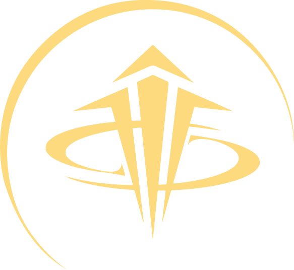
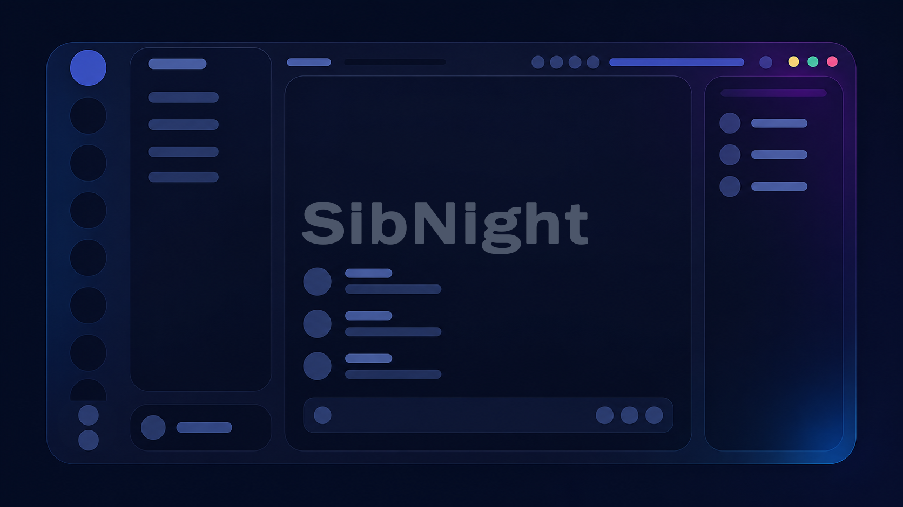
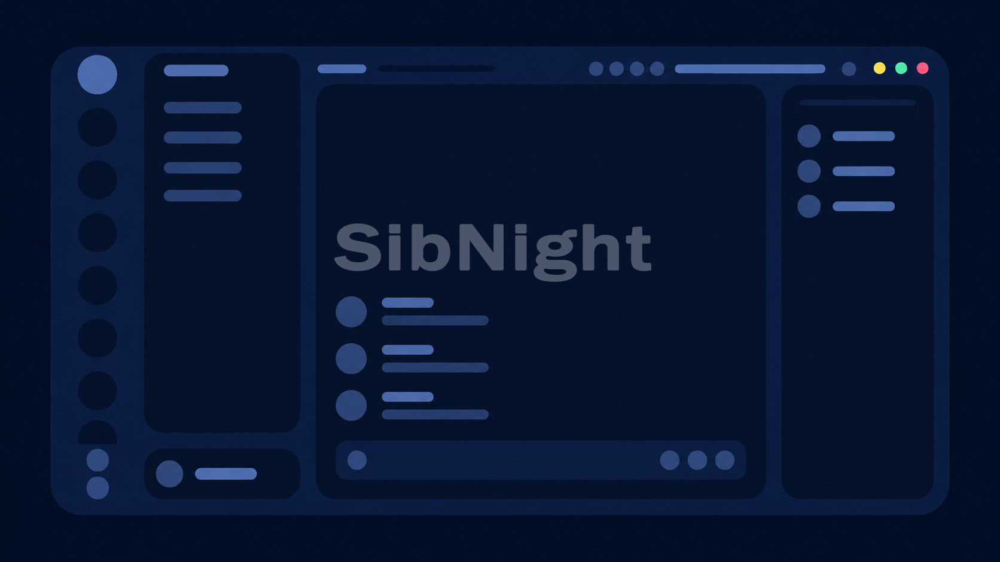
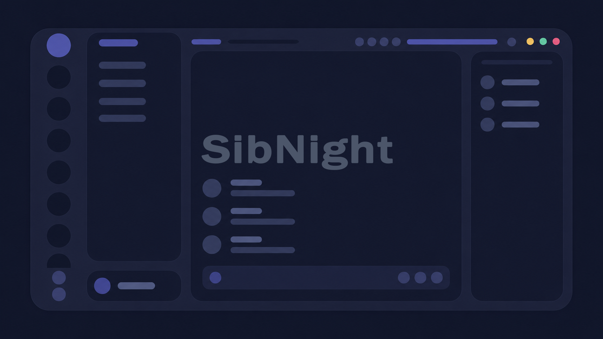
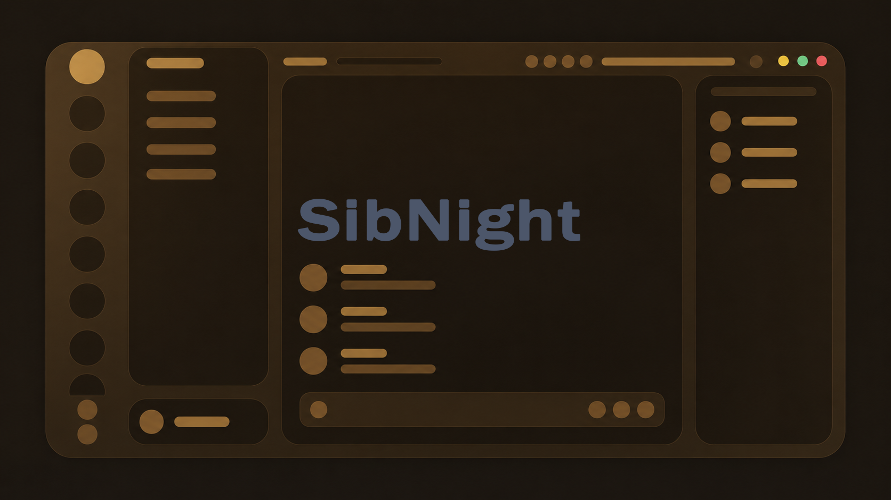
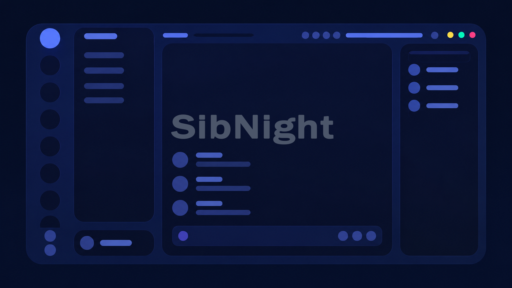
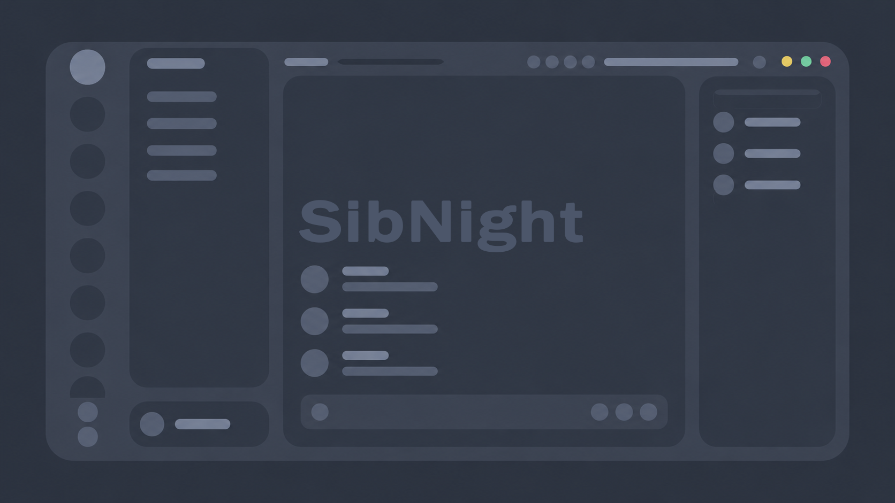
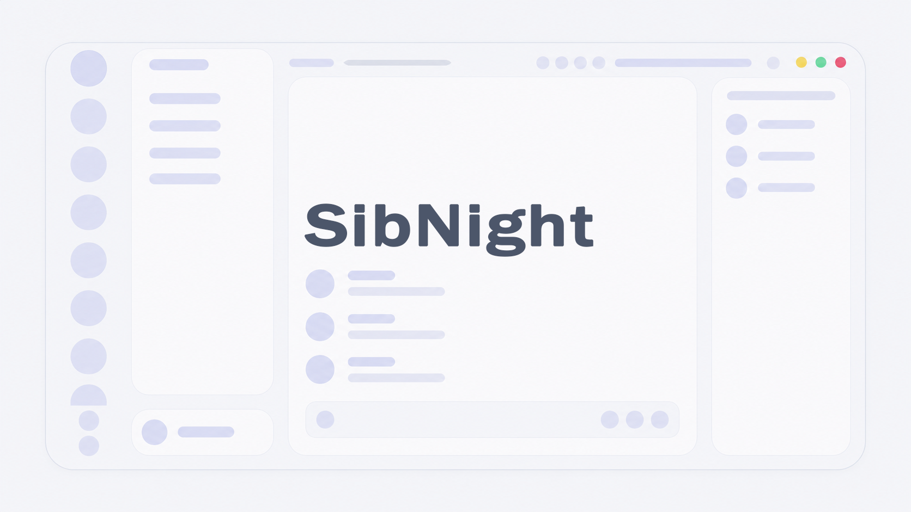
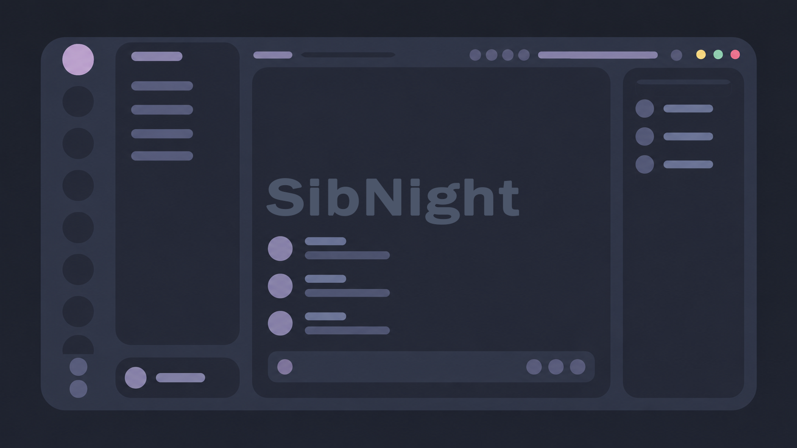
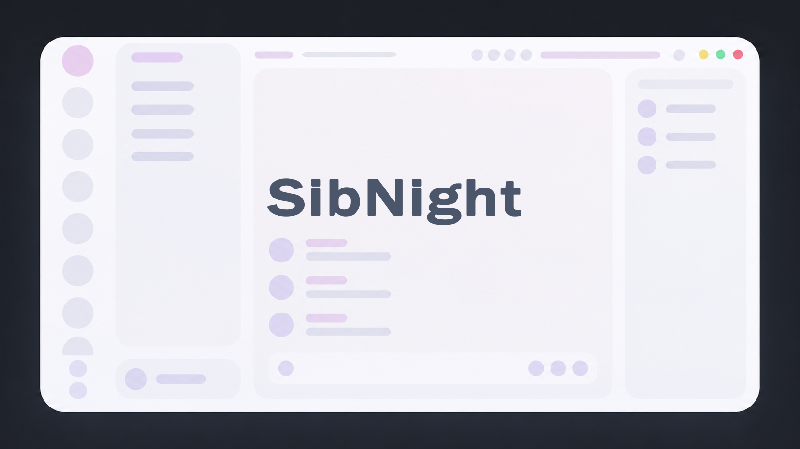

<p align="center">
  
</p>

<h1 align="center">sibnight</h1>

<p align="center">
  A dark Discord theme inspired by Sibylla's visual identity.
</p>

<p align="center">
  
</p>

## Installation

### File installation

For **BetterDiscord** or **Vencord desktop**:

1. Download `themes/sibnight.theme.css`.
2. Place the file in your Discord client's themes folder.
3. Enable **sibnight-discord** or the chosen flavor. Enable only one Sibnight variant at a time.

### Link installation

In Vencord, add this URL under **Themes / Online Themes**. BetterDiscord users should use file installation:

```text
https://ussmarines.github.io/DiscordTheme/themes/sibnight.theme.css
```

To customize the theme, copy the relevant `body` or `:root` variable block from the installed file into **Vencord QuickCSS** or **BetterDiscord Custom CSS**. For example:

```css
body {
    --gap: 12px;
    --animations: off;
    --panel-blur: off;
}
```

Existing `--sibylla-*` and legacy variables remain supported. Figtree loads from Google Fonts; the home logo loads from this repository. The theme installs no JavaScript.

These third-party client modifications are **not officially supported by Discord**. Client modifications conflict with [Discord's terms](https://discord.com/terms), as also stated in the [Vencord FAQ](https://vencord.dev/faq/). Compatibility means CSS theme loading, not certification of every Discord screen or mobile support.

The previews below are historical illustrations, not evidence of current Discord compatibility.

## Flavors

Flavors are predefined variants of **sibnight**. Each flavor is a standalone `.theme.css` file that imports the shared base `build/sibnight-flavor.css`.

To use a flavor, install the matching file from `themes/flavors/` instead of the main theme.

<table>
  <tr>
    <td width="50%" align="center" valign="top">
      <a href="./themes/flavors/sibnight-flat.theme.css">
        
      </a>
      <br>
      <strong>sibnight-flat</strong>
      <br>
      <code>themes/flavors/sibnight-flat.theme.css</code>
    </td>
    <td width="50%" align="center" valign="top">
      <a href="./themes/flavors/sibnight-tokyo-night.theme.css">
        
      </a>
      <br>
      <strong>sibnight-tokyo-night</strong>
      <br>
      <code>themes/flavors/sibnight-tokyo-night.theme.css</code>
    </td>
  </tr>
  <tr>
    <td width="50%" align="center" valign="top">
      <a href="./themes/flavors/sibnight-sun.theme.css">
        
      </a>
      <br>
      <strong>sibnight-sun</strong>
      <br>
      <code>themes/flavors/sibnight-sun.theme.css</code>
    </td>
    <td width="50%" align="center" valign="top">
      <a href="./themes/flavors/sibnight-space.theme.css">
        
      </a>
      <br>
      <strong>sibnight-space</strong>
      <br>
      <code>themes/flavors/sibnight-space.theme.css</code>
    </td>
  </tr>
  <tr>
    <td width="50%" align="center" valign="top">
      <a href="./themes/flavors/sibnight-north-polar.theme.css">
        
      </a>
      <br>
      <strong>sibnight-north-polar</strong>
      <br>
      <code>themes/flavors/sibnight-north-polar.theme.css</code>
    </td>
    <td width="50%" align="center" valign="top">
      <a href="./themes/flavors/sibnight-north-snow.theme.css">
        
      </a>
      <br>
      <strong>sibnight-north-snow</strong>
      <br>
      <code>themes/flavors/sibnight-north-snow.theme.css</code>
    </td>
  </tr>
  <tr>
    <td width="50%" align="center" valign="top">
      <a href="./themes/flavors/sibnight-north-aurora-dark.theme.css">
        
      </a>
      <br>
      <strong>sibnight-north-aurora-dark</strong>
      <br>
      <code>themes/flavors/sibnight-north-aurora-dark.theme.css</code>
    </td>
    <td width="50%" align="center" valign="top">
      <a href="./themes/flavors/sibnight-north-aurora-light.theme.css">
        
      </a>
      <br>
      <strong>sibnight-north-aurora-light</strong>
      <br>
      <code>themes/flavors/sibnight-north-aurora-light.theme.css</code>
    </td>
  </tr>
</table>

## Remote import links

```text
https://ussmarines.github.io/DiscordTheme/themes/sibnight.theme.css
https://ussmarines.github.io/DiscordTheme/themes/flavors/sibnight-flat.theme.css
https://ussmarines.github.io/DiscordTheme/themes/flavors/sibnight-tokyo-night.theme.css
https://ussmarines.github.io/DiscordTheme/themes/flavors/sibnight-sun.theme.css
https://ussmarines.github.io/DiscordTheme/themes/flavors/sibnight-space.theme.css
https://ussmarines.github.io/DiscordTheme/themes/flavors/sibnight-north-polar.theme.css
https://ussmarines.github.io/DiscordTheme/themes/flavors/sibnight-north-snow.theme.css
https://ussmarines.github.io/DiscordTheme/themes/flavors/sibnight-north-aurora-dark.theme.css
https://ussmarines.github.io/DiscordTheme/themes/flavors/sibnight-north-aurora-light.theme.css
```

## Development

### Compatibility status — 24 October 2026

Sibnight 2.15.1 / North Polar 2.1.1 rebuilds the shared principal theme around **Lecture et repères**, with the connected-user block from **Cabinet initial**. North Polar remains a dark skin using the [official Nord palette](https://www.nordtheme.com/docs/colors-and-palettes/). Native content, custom profiles, unread indicators and keyboard focus are preserved.

`src/workspace.css` now owns the continuous columns, reading rhythm, header tools and voice/account dock in the principal source manifest. `src/north-polar.css` supplies the Nord semantic palette after `flavor-base.css`. This is a shared-core change: the other eight variants are retained, but their visual validation is explicitly deferred.

Conversation text uses a 74ch limit and 1.5 line height. Threads remains beside notifications and pins. Four original embedded outline glyphs cover threads, pins, members and search; multi-state notification, voice and composer controls retain Discord glyphs. There is no new icon dependency or remote resource.

The [function-by-function validation matrix](docs/DISCORD_FUNCTIONS.md) distinguishes visible controls, opened menus and executed operations. Read-only checks cover search results, reception, message menus, reply preparation/cancellation, profiles, media pickers, voice settings and Vencord. A real 1101 × 801 window exposed a clipped account row; the dock now grows with its controls. North Polar is observed active in the installed client.

Build checks, six Node tests, npm audit and 24 North Polar Chromium assertions pass at the recorded checkpoint. Synthetic CSS tests do not certify every Discord interaction. The final targeted Impeccable review passes after correcting account overflow and excessive member-name truncation. Member widths of 288px / 280px preserve native row height, badges and custom nameplates. This review covers the supplied real desktop/narrow views, not every Discord screen. Camera input is unavailable. BetterDiscord, the other variants, OS accessibility modes, new calls/sharing, uploads and content publication are not validated in this pass. See [maintenance](docs/MAINTENANCE.md) and [the design system](DESIGN.md). Gallery images above remain historical.

The project keeps two generated CSS files:

- `build/sibnight.css` for the main theme.
- `build/sibnight-flavor.css` for flavors, with their shared base.

Useful commands:

```bash
npm run build
npm run check
npm run prepare:release
npm run quality
npm run check:urls
npm run bundle
node scripts/browser-fixture.js
```

Run `npm run build` after changing CSS sources, then `npm run check` before publishing. `npm run prepare:release` runs both steps in the correct order.

Use **Node.js 24 or newer**, then `npm ci --ignore-scripts`. `npm run quality` builds, checks syntax/imports/metadata/freshness and CSS invariants, runs Node tests, checks whitespace and audits all dependencies. Also run `git diff --check`. PostCSS is used only as a parser, without transformation plugins.

The development watcher uses Chokidar 6, an ESM dependency supported by Node 24's `require(esm)` interoperability; the project scripts remain CommonJS. Both supported runtime lines are tested. Serve `output/browser-fixture.html` on loopback and inspect the nine result rows to run the browser checks; generating the HTML alone is not a passing test.

For development, set `DEV_OUTPUT_PATH` in the process environment and run `npm run dev`. Comma-separated `.theme.css` destinations must be outside the repository or inside ignored `output/`. `.env` is no longer loaded automatically. PowerShell example:

```powershell
$env:DEV_OUTPUT_PATH = 'output/dev.theme.css'
npm run dev
```

`npm run bundle` creates nine **frozen CSS snapshots** in `output/themes/`, without remote CSS imports or webfont loading. The home logo remains a remote image. Save a known-good snapshot outside this repository for rollback; disable the live theme before enabling the snapshot. Reverting published changes uses a new revert commit, never a force-push.

Pages serves `main` from the repository root. After deployment, run `npm run check:urls -- --match-local` to verify MIME types and exact normalized CSS content. The class updater uploads a patch for review, retained 14 days, and cannot push. Releases are manual only. See [maintenance and grouped Discord checks](docs/MAINTENANCE.md).

## Structure

- `themes/sibnight.theme.css`: main file to install.
- `themes/flavors/`: `.theme.css` files for the eight existing flavors.
- `src/`: source CSS modules used to generate the build.
- `build/`: generated CSS published through GitHub Pages.
- `assets/readme/`: screenshots used in this README.
- `scripts/`: Node scripts for build, development, and checks.
- `AGENDA.md`: compact current checkpoint.
- `docs/MAINTENANCE.md`: module map, evidence, update procedure and manual checklist.

## Credits

- Original design inspired by [Zelk](https://github.com/schnensch0/zelk).
- Theme design inspired by [Midnight](https://github.com/refact0r/midnight-discord).
- Window controls inspired by [Tokyo Night](https://github.com/Dyzean/Tokyo-Night).

The main author of this project is **ussmarines**.
